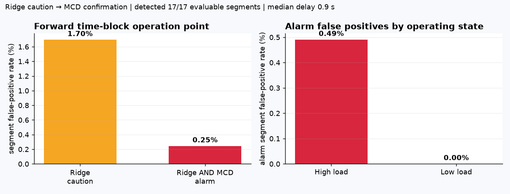
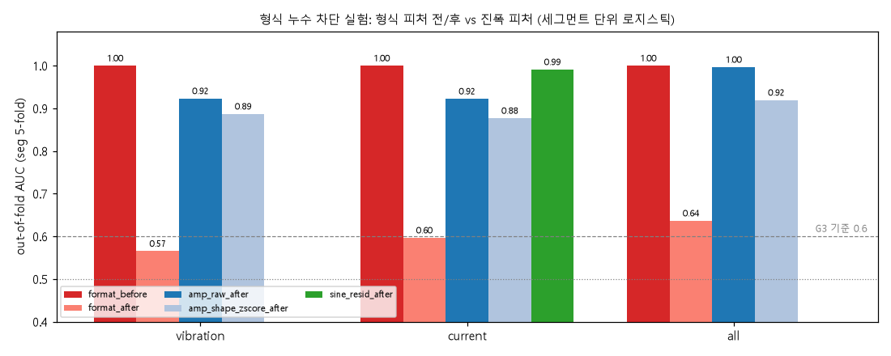
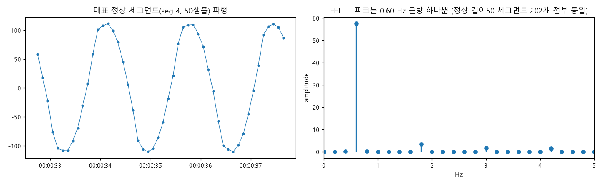
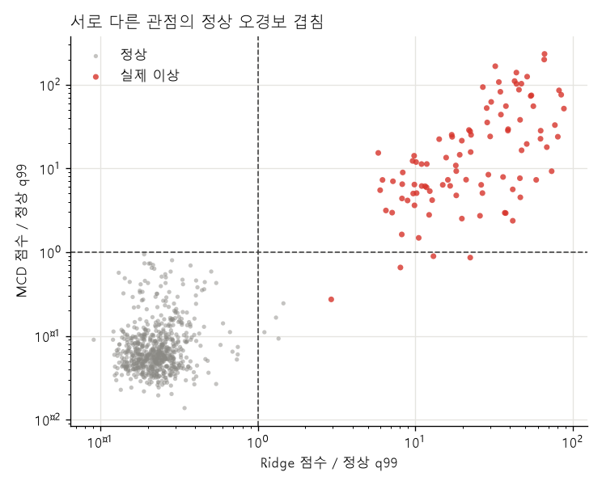
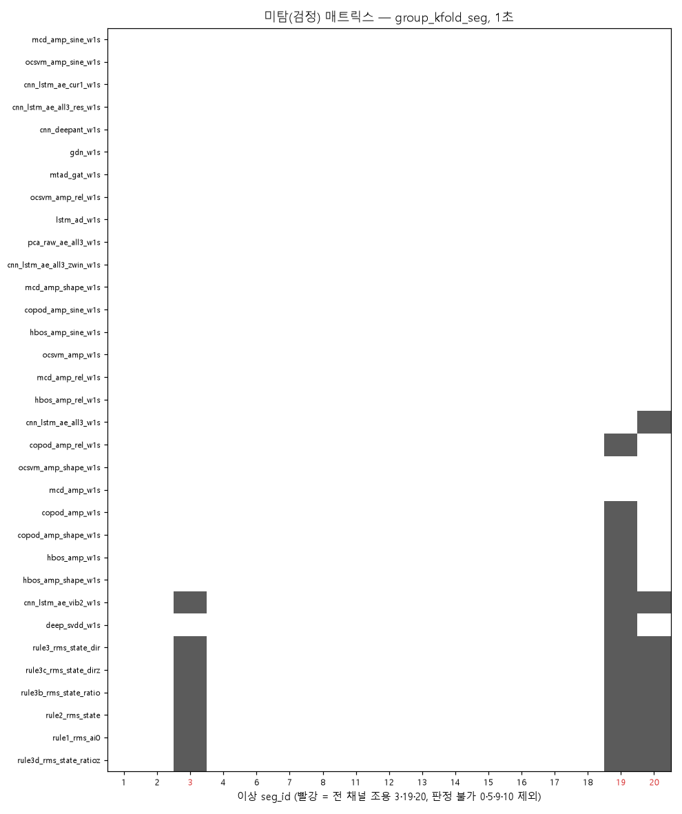
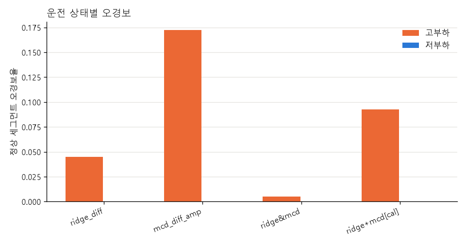

# 진동·전류 시계열 기반 프레스 유압펌프 이상 조기탐지 및 오경보 분석

제6회 K-인공지능 제조데이터 분석 경진대회 · 주제 ③ (선정 근거: [docs/topic_selection.md](docs/topic_selection.md))

파인블랭킹 프레스 유압 유닛의 진동 2채널(상부 AI0·하부 AI1)과 전류 1채널(AI2)만으로 **유압펌프 모터-펌프 구동부 이상**을 정상 데이터만 학습해 일찍 알리고, 정상 운전을 이상으로 오인하는 오경보를 줄이는 2단계 경보 체계를 만들었다.

> **최종 모델: Ridge-VAR(1차 차분 입력) + MCD 2단계 경보**
> - 주의 = Ridge z > 1 → 점검 목록 등록, 다음 세그먼트 재확인
> - 경보 = Ridge AND MCD z > 1 (같은 1초 윈도우) → 즉시 설비 확인·정지 판단
> - time-block 기준 실제 이상 17/17 탐지, 세그먼트 오경보율 주의 1.70% → 경보 **0.25%**, 판정 지연 중앙값 **0.9초**

| 단계 | 규칙 | 분할 | AUC | 세그먼트 오경보율 | 실제 이상 탐지 | 지연 중앙값 |
|---|---|---|---|---|---|---|
| 주의 | Ridge z > 1 | GroupKFold | 1.0000 | 2.06% | 17/17 | 0.9초 |
| 경보 | Ridge AND MCD z > 1 | GroupKFold | 0.9954 | 0.00% | 17/17 | 0.9초 |
| 주의 | Ridge z > 1 | time-block | 1.0000 | 1.70% | 17/17 | 0.9초 |
| 경보 | Ridge AND MCD z > 1 | time-block | 0.9991 | 0.25% | 17/17 | 0.9초 |

출처: [results/summary_final.csv](results/summary_final.csv), 노트북 [23](notebooks/23_model_ensemble_ridge_mcd_JSC.ipynb). 이상 이벤트가 1건(판정 가능 세그먼트 17개)이라 모든 정상 대 이상 수치는 이 이벤트에 대한 기술이며, 여러 고장으로 일반화한 성능이 아니다.



---

## 목차

1. [데이터 이해 및 진단](#1-데이터-이해-및-진단)
2. [AI 예측모델 개발 및 성능평가](#2-ai-예측모델-개발-및-성능평가)
3. [영향요인 및 오류분석](#3-영향요인-및-오류분석)
4. [현장 활용방안](#4-현장-활용방안)
5. [창의성·차별성](#5-창의성차별성)
6. [재현 방법](#6-재현-방법)
7. [저장소 구조와 노트북 지도](#7-저장소-구조와-노트북-지도)
8. [한계](#8-한계)
9. [작업 규칙](#9-작업-규칙)

---

## 1. 데이터 이해 및 진단

### 데이터 구성

| 구분 | 행 수 | 수집일 | 기간 | 세그먼트(burst) | 판정 가능(1초 / 2초) |
|---|---|---|---|---|---|
| 정상 | 20,000 | 2022-07-12 | 77분 | 599 | 530 / 452 |
| 이상 | 600 | 2022-07-17 | 2분 46초 | 21 | 17 / 13 |

- 10 Hz 샘플이 최대 5초 burst로 끊겨 들어온다. 판정·분할·오경보율의 기본 단위는 세그먼트다.
- 세그먼트 시작 간격 중앙값 **7.96초**가 조기탐지 지연의 구조적 하한이다(체감 지연 = 판정 지연 0.9초 + 7.96초 = 8.86초).
- 결측 0, 타임스탬프 역행 0, 평균 제거 후 5σ 초과 0. 품질 문제는 결측·이상치가 아니라 **수집 형식 차이**와 **이상 이벤트 1건의 불균형**이다.

### 핵심 진단 결과

| 발견 | 근거 수치 | 모델링에 반영한 방식 |
|---|---|---|
| **파일 형식 누수** — 수치 저장 형식만으로 라벨이 맞는다 | \|DC 오프셋\| 단독 AUC AI0 0.944 / AI1 0.920 / 전류 0.891, 전류값 1.19209 배수 비율 정상 0.19% vs 이상 99.67% | 수치 형식 통일(진동 6자리, 전류 1.19209 격자) + 세그먼트 평균 제거 → 형식 피처 AUC 1.00 → **진동 0.566 / 전류 0.597** (통과 기준 0.6) |
| **전류 에일리어싱** — 60 Hz 구동 전류가 10 Hz 샘플링에서 0.6 Hz로 접힘 | 정상 사인 적합 R² 0.9965 | 결함 주파수 분석 배제, 시간영역 진폭 18열(RMS·피크·p2p·첨도·crest·왜도 × 3채널) 중심 |
| **운전 상태 2개** — 고부하·저부하를 325회 오감 | 고부하 43.2% / 저부하 56.8%, k-평균 실루엣 0.599 | 부하 변화를 이상으로 보지 않도록 분석 층으로 사용 |
| **채널별 라벨 불일치** | 진동·전류 등급이 다른 세그먼트 16/21, 3·19·20은 진동이 정상 유사 | 채널별 soft label, 미탐 분석의 출발점 |
| **이상 내 점진 악화 없음** | AC 피처 6개 추세 검정 모두 p > 0.05 | 과제를 "열화 예지"가 아닌 "정상 이탈의 빠른 탐지"로 정의 |
| **날짜 = 라벨** | 이상은 다른 날 이벤트 1건 | 절대 시간 피처 금지, 세그먼트 단위 GroupKFold(5 fold) + 정상 시간순 4블록(time-block) |





- 임계·표준화·PCA는 학습 fold의 정상 데이터로만 적합하고 임계는 q99로 둔다. 이상 데이터로 임계·피처·하이퍼파라미터를 고르지 않는다.
- 세그먼트 전체 상관처럼 미래 샘플을 쓰는 피처는 누적(causal) 형태로 바꾸면 규칙 AUC가 0.867 → 0.844로 내려간다(순위 이득의 약 1/3이 미래 정보) → 운영 피처는 누적 형태로 제한한다.
- 기각한 전처리: 공백 보간(hold-out 진동 R² ≤ 0), 고역 필터(DC 스텝 직후 오차 > AC 표준편차), baseline·expanding 평균(누수 부활), detrend(PCA time-block 오경보 0.0381 → 0.0535).

상세: [01 품질 진단](reports/01_data_quality.md) · [02 심층 진단](reports/02_diagnosis_deep.md) · [03 재점검](reports/03_diagnosis_recheck_CHS.md) · [04 정상 프로파일](reports/04_data_profile_CHS.md) · [13 DC 제거 대안](reports/13_preprocess_dc_check_CHS.md) · [14 공백 보간](reports/14_gap_interpolation_check_JIW.md)

## 2. AI 예측모델 개발 및 성능평가

이동 RMS 규칙을 베이스라인으로 두고 예측·분포·복원·그래프 원리를 대표하는 모델을 같은 전처리·분할·임계(학습 정상 q99) 조건에서 비교했다. AUC는 상위 모델에서 포화하므로 **세그먼트 F1과 오경보율**로 운영 적합성을 갈랐다.

### 1초 윈도우 대표 모델 비교 (판정 가능 정상 530 · 이상 17)

| 모델 | 원리 | AUC (GKF/TB) | 세그먼트 F1 (GKF/TB) | 오경보율 (GKF/TB) | 미탐 (GKF/TB) |
|---|---|---|---|---|---|
| 이동 RMS (베이스라인) | 단변량 진폭 임계 | 0.7864 / 0.7786 | 0.5385 / 0.8062 | 3.95% / 3.84% | 3 / 3 |
| Naive | 직전값 유지 예측 | 0.8221 / 0.8140 | 0.5455 / 0.7157 | 4.34% / 10.96% | 2 / 2 |
| Kalman | 상태공간 예측 오차 | 0.9040 / 0.8925 | 0.6122 / 0.7437 | 3.17% / 8.79% | 2 / 2 |
| Isolation Forest | 트리 기반 분리 | 0.9878 / 0.9851 | 0.5614 / 0.7584 | 4.46% / 9.25% | 1 / 1 |
| **Ridge-VAR (1차 차분)** | 선형 시계열 예측 오차 | **1.0000 / 1.0000** | **0.7556 / 0.9523** | **2.06% / 1.70%** | **0 / 0** |
| CNN (DeepAnT) | 비선형 시계열 예측 | 0.9999 / 0.9999 | 0.6667 / 0.8981 | 3.17% / 3.87% | 0 / 0 |
| MTAD-GAT | 변수 관계 그래프 | 0.9999 / 0.9997 | 0.6892 / 0.8952 | 2.86% / 3.94% | 0 / 0 |
| MCD (1차 차분 진폭) | 강건 다변량 거리 | 0.9917 / 0.9968 | 0.6000 / 0.8063 | 4.29% / 8.63% | 0 / 0 |
| PCA AE | 선형 복원 오차 | 0.9995 / 0.9998 | 0.6071 / 0.8956 | 4.13% / 3.81% | 0 / 0 |
| CNN+LSTM AE | 비선형 복원 오차 | 0.9927 / 0.9810 | 0.4273 / 0.7340 | 7.65% / 9.44% | 1.33 / 1.75 |
| 가이드북 LSTM-AE | 공식 가이드북 재현 | 0.8632 / 0.7413 | 0.6286 / 0.6218 | 1.30% / 2.40% | 6 / 8.25 |

GKF = 세그먼트 GroupKFold 5 fold 합산, TB = 정상 시간순 4블록 평균(두 분할은 분모가 달라 서로 비교하지 않는다). 전체 1초 44행·2초 27행은 [results/model_comparison.csv](results/model_comparison.csv).

### 최종 모델 선정

- **Ridge-VAR**: 과거 5개 시점의 세 채널 1차 차분 값으로 다음 시점을 예측하고 예측 오차를 점수로 쓴다. 현재·직전 샘플만 쓰는 causal 입력, 신경망 가중치 없는 재현, 최저 오경보를 함께 만족한다. 모델 내부 최악 처리시간 0.388 ms.
- **MCD**: 같은 1차 차분 신호의 진폭 18열로 정상 분포의 강건 Mahalanobis 거리를 계산한다. 단독으로도 17/17을 잡지만 time-block 오경보 8.63%라 **확인용**으로 쓴다.
- **AND 결합**: 두 모델의 정상 오경보 Jaccard가 0.000 / 0.041로 거의 겹치지 않아, 같은 창에서 둘 다 넘을 때만 경보하면 탐지와 지연을 유지한 채 오경보가 줄어든다. time-block paired bootstrap에서 AND와 Ridge 단독의 오경보율 차이 구간은 −2.64%p ~ −0.48%p(0 미포함). OR(9.83%)·평균(4.10%)은 기각했다.
- **약한 이상**: 합성 이상 강도 1에서 탐지율은 주의 0.3505, 경보 0.1633 → 약한 징후는 주의 단계가 맡아야 하므로 2단계를 유지한다.
- **대조 구현**: CNN(DeepAnT) + MCD(2초)와 공통 세그먼트(정상 452 · 이상 13)에서 비교하면 둘 다 13/13 탐지, 오경보율 차이 95% 구간 4개 모두 0 포함. 성능으로 갈리지 않는 상황에서 지연(0.9초 vs 1.9초), 추가 판정 범위(정상 78 · 이상 4 세그먼트), causal 재현성으로 Ridge 체계를 택했다.



상세: [21 규칙 베이스라인](notebooks/21_model_rule_baseline_CHS.ipynb) · [22 고전 시계열](reports/22_model_classical_timeseries_JSC.md) · [23 Ridge·MCD 앙상블](reports/23_model_ensemble_ridge_mcd_JSC.md) · [24 예측](reports/24_model_forecasting_JIW.md) · [25 그래프](reports/25_model_graph_JIW.md) · [26 분포](reports/26_model_distribution_JIW.md) · [27 CNN+LSTM AE](reports/27_model_cnn_lstm_ae_CHS.md) · [28 대조 구현 앙상블](reports/28_model_ensemble_JIW.md) · [29 가이드북 LSTM-AE](reports/29_model_guidebook_lstm_ae_JIW.md)

## 3. 영향요인 및 오류분석

### 영향변수

| 변수 | 채택 | 단독 효과(ablation) |
|---|---|---|
| 진폭 18열 | 주 변수 | 에일리어싱으로 주파수 분석 불가 → 진동·전류 공통 축 |
| 전류 채널 | 필수 | 진동만 쓰면 3·19·20 미탐, 전류 파형을 쓰는 주력 모델은 미탐 0 |
| 운전 상태 | 분석 층 | CNN 기준 오경보 고부하 7.52% vs 저부하 0.33% |
| 형상(z-score) | 보조 | 오경보를 없애지 못하고 저부하로 옮김(3.54% → 23.03%) |
| 전류 사인 잔차 | 별도 묶음 | 단독 AUC 1.0 근방, 날짜 교란 가능성 |
| 세그먼트 전체 상관 · 절대 시간 | 제외 · 금지 | 미래 샘플 사용 · 날짜 = 라벨 |

- 이상에서는 변수 간 관계가 뒤집힌다(채널 쌍 465개 중 |Δρ| ≥ 0.5가 93개, 하부 진동 p2p–crest 상관 −0.404 → +0.520). 3·19·20은 단변량 진폭으로는 조용하지만 진폭 18열 PCA SPE·T²로는 정상 q99의 3.1~4.3배 밖에 있다 → 약한 이상은 다변량 관계로 봐야 한다.

### 미탐(FN)이 집중되는 조건

| 유형 | 세그먼트 | 놓치는 모델 (GKF 1초) | 해석 |
|---|---|---|---|
| 단변량·진동 전용 입력의 한계 | 3·19·20 | 규칙 7종, 진동 2채널 AE, Naive·Kalman(19·20) | 진동·전류 AC 진폭이 모두 조용함. 라벨 오류가 아니라 입력 한계 |
| 피처 간 관계를 못 쓰는 모델 | 19 | COPOD·HBOS, DeepSVDD, Isolation Forest (각 1 fold) | 독립 가정·축 정렬 분리·단일 구 경계 |
| 예외 | 3·4·14·18·19·20 등 | 가이드북 LSTM-AE | 누수 제거와 학습 길이 축소 효과를 분리하지 못함 |

최종 Ridge-VAR + MCD 체계는 주의·경보 단계 모두 **미탐 0**이다. 1초 GKF 44행 중 25행이 미탐 0이라 모델 간 차이는 오경보에서 난다.

<p align="center"></p>

### 오경보(FP)가 집중되는 조건

- **고부하 운전의 진동 상단 꼬리**: 32모델 중 23개가 고부하에 집중(Fisher 정확 검정 + BH 보정). 예) CNN 7.52% vs 0.33%, MCD 9.29% vs 0.99%, HBOS 12.39% vs 0.33%.
- **같은 세그먼트에 반복**: 과반 모델이 FP를 낸 7개 세그먼트는 전부 고부하이고 6개가 04 정상 의심 세그먼트(26개)와 겹친다 → 모델 결함이 아니라 정상 고부하 분포의 꼬리 문제.
- **세그먼트 시작 직후**(시작 윈도우 임계 초과 3.40% vs 3.5~4초 구간 0.23%)와 **time-block 중간 블록**.
- 저감 수단 검증: 상태별 임계(고부하 3.2% → 3.1%)와 k-of-n·시작 윈도우 제외(오경보율을 맞추면 any가 F1 최고, k-of-n은 지연 0.9 → 1.4초)는 효과가 없어 기각했고, **서로 다른 계열의 AND만** 오경보를 줄였다.



상세: [31 오류분석](reports/31_error_analysis_CHS.md) · [32 경보 근거 설명](reports/32_alarm_explain_JIW.md) · [32 운영점](reports/32_operating_point_CHS.md) · [35 평가 상세](reports/35_eval_detail_JIW.md)

## 4. 현장 활용방안

```
① 측정: 상부·하부 진동 + 전류, 10 Hz burst
② 판정: 1초 윈도우를 0.5초씩 이동 → 1차 차분 → Ridge·MCD 점수 → z = 점수 / 학습 정상 q99
③ 조치: 주의(Ridge z > 1) / 경보(Ridge AND MCD z > 1), 경보 ⊂ 주의
```

| 단계 | 판정 규칙 | 시간당 거짓 알림 (GKF / TB) | 실제 이상 탐지 | 현장 조치 |
|---|---|---|---|---|
| 주의 | Ridge z > 1 | 약 8.5 / 7.0건 | 17/17 | 점검 목록 등록, 다음 세그먼트 추세 확인 |
| 경보 | Ridge AND MCD z > 1 | 약 0.0 / 1.0건 | 17/17 | 즉시 설비 상태 확인, 필요 시 정지 판단 |

시간당 거짓 알림 = 세그먼트 오경보율 × 시간당 판정 가능 세그먼트 413.35개(정상 76.93분 외삽, 가정값).

- **사전경보**: 합성 열화 시나리오 144개에서 주의는 열화 2·5·10분 모두 완성 전에 울렸다(선행 시간 중앙값 1.39·3.60·7.39분, 대조 구현 프로토타입 기준). 도달 시간 추정은 오차가 커서 "위험 상승 중" 정성 표시만 둔다.
- **점검 우선순위**: 경보에 가장 크게 벗어난 신호와 z 배수를 붙인다. AND 오경보 카드는 z 1.0~1.7로 임계 바로 위, 실제 이상 창은 z 5.8~71.8 → 배수로 고부하 오경보와 실제 이상을 구분한다. 원인 부위(모터/펌프)는 센서 부착 위치를 확정할 수 없어 단정하지 않는다.
- **오경보 대응 규칙**: 고부하 단발 주의는 즉시 정지하지 않고 다음 세그먼트에서 재확인, 정지 판단은 AND 경보에만 연결.
- **임계 재보정**: 설치 직후 정상 데이터만으로 q99 임계 산정 → 운전 상태 구성이 바뀌거나 월별 정상 오경보율이 목표의 2배를 넘으면 재산정 [가정].
- **품질검사 연계**: 경보 시간대 생산 로트의 검사 우선순위 상향 [가정, 제품·로트 정보 없음].
- **시연**: 외부 서버·계정 없이 브라우저로 여는 단일 HTML 대시보드 [figures/37_ridge_mcd_dashboard_JSC/dashboard.html](figures/37_ridge_mcd_dashboard_JSC/dashboard.html) (저장 데이터 재생, 생성 전 계약 6/6 자동 점검).

상세: [33 조기경보](reports/33_early_warning_JIW.md) · [34 실시간 입력 검증](reports/34_realtime_input_validation_JSC.md) · [34 경보 챗봇](reports/34_alarm_chatbot_JIW.md) · [37 대시보드](reports/37_ridge_mcd_dashboard_JSC.md)

## 5. 창의성·차별성

| 차별점 | 근거 수치 | 기여 |
|---|---|---|
| 신호 물리 기반 누수 차단 | 에일리어싱 규명, 형식 피처 AUC 1.00 → 0.57 / 0.60 | 모델이 설비가 아니라 파일 저장 방식을 맞히는 평가를 차단 |
| causal 입력과 지연 분리 | 규칙 AUC 0.867 → 0.844, 판정 지연 0.9초 + 수집 간격 7.96초 | 미래 정보 없이 판정, 체감 지연을 간격 포함으로 보고 |
| 이상 1건 대응 평가 설계 | 정상만 학습, 합성 강도 0.25~8, 분모 530·17 / 452·13 구분 | 임계·피처를 이상으로 고르지 않아 과대평가 방지 |
| 오류 비겹침 AND + 2단계 경보 | Jaccard 0.000 / 0.041, TB 오경보 1.70% → 0.25% | 경량 두 모델로 확정 경보 오경보 약 1/7 |
| 두 구현의 교차 검증 | 공통 세그먼트 차이 구간 4개 모두 0 포함, 13/13 | 결론이 특정 모델 쌍에 의존하지 않음 |
| 컨포멀 p-value와 보장 조건 검증 | 시간순 calibration 시 명목 alpha의 2.0~3.4배, 무작위 시 0.1019 → 0.0453 | "정상이라면 이만큼 극단적일 확률의 상한" 보조 출력 + 재보정 규칙 |

상세: [36 컨포멀 p-value](reports/36_conformal_pvalue_CHS.md)

## 6. 재현 방법

Python 3.12 기준이다. 원본 데이터는 git에 포함하지 않으므로 `data/`에 `3. 소성가공 예지보전 AI 데이터셋.zip`을 넣는다([data/README.md](data/README.md)). 압축 해제는 노트북에서 자동으로 수행된다(`python src/extract.py`로 직접 할 수도 있다).

```bash
python -m venv .venv && .venv/Scripts/activate      # Windows
pip install -r requirements.txt                     # torch 설치 실패 시 --index-url https://download.pytorch.org/whl/cpu

python src/run_all.py --quick                       # 결정적 노트북 7개(최종 모델 23 포함), 재학습 없음, CPU 약 3분
python src/run_all.py                               # 전체 순차 실행(가중치·캐시가 없으면 재학습, CPU 약 2.5시간)
python src/run_all.py --only 34_realtime_input_validation_JSC,23_model_ensemble_ridge_mcd_JSC,37_ridge_mcd_dashboard_JSC
python src/export_predictions.py                    # 테스트 데이터 예측결과 → predictions/
```

- `run_all.py`는 시작 시 필수 패키지를 점검하고(`--install`이면 설치까지), 끝나면 최종 모델 요약을 [results/summary_final.csv](results/summary_final.csv)에 남긴다. 팀 로컬 커널은 `--kernel kamp`.
- 실행 순서는 번호순이 아니라 입력 의존 순서다(예: 04는 11의 `11_window_features.parquet`을 읽는다). 순서는 `src/run_all.py`의 `ORDER`에 고정되어 있다.
- 34 경보 챗봇은 로컬 LLM(약 3 GB) 다운로드가 필요해 순차 실행에서 제외한다(판정 성능과 무관).
- Windows에서 한글 출력 깨짐 방지: `PYTHONUTF8=1`.

**재실행 점검**([docs/reproducibility_check.md](docs/reproducibility_check.md)): 가중치·캐시 없이 24개 노트북 재실행 약 153분, 결정적 결과 차이 0 또는 최대 절대차 2×10⁻¹¹ 이하, 딥러닝 오경보율 변동 대부분 0.003 이내(최종 순위 불변), 대시보드 계약 6/6 통과, 오류·미실행 셀 0. `src/repro_compare.py`가 재실행 결과와 커밋본을 파일별로 자동 대조한다.

## 7. 저장소 구조와 노트북 지도

```
KAMP/
├─ README.md
├─ CLAUDE.md               # 팀 공유 규칙 (커밋·브랜치·PR, 심사 기준, 작업 도메인)
├─ requirements.txt        # Python 3.12 기준 고정 버전
├─ data/                   # 원본 zip + raw/·processed/ (git 제외) — data/README.md
├─ notebooks/              # 실행 결과 포함 노트북, _template.ipynb, scratch/(git 제외)
├─ src/                    # 재사용 코드: paths·preprocess·split·features·models·evaluate, run_all 등
├─ figures/<노트북명>/     # 노트북별 그림
├─ results/<노트북명>/     # 노트북별 지표·오류 사례 CSV — results/README.md
│  ├─ model_comparison.csv #   전체 모델 비교표
│  └─ summary_final.csv    #   최종 모델 요약
├─ reports/                # 노트북별 요약 md (발견 → 시사점 → 활용)
├─ predictions/            # 테스트 데이터 예측결과 — predictions/README.md
├─ models/                 # 모델 가중치 (git 제외, 재학습으로 재현)
└─ docs/                   # 보고서·설계서·재현성 점검·주제 선정 기록
```

| 대역 | 노트북 | 내용 |
|---|---|---|
| 0x 진단 | 01 · 02 · 03 · 04 | 품질 진단, 형식 누수·채널별 등급, 누수 차단 재점검, 정상 운전 상태 프로파일 |
| 1x 전처리·피처 | 11 · 12 · 13 · 14 | 윈도우 피처, 피처 통계, DC 제거 대안 비교, 공백 보간 검증 |
| 2x 모델 | 21 · 22 · **23** · 24 · 25 · 26 · 27 · 28 · 29 | 규칙 베이스라인, 고전 시계열, **최종 Ridge·MCD**, 예측, 그래프, 분포, CNN+LSTM AE, 대조 구현 앙상블, 가이드북 LSTM-AE |
| 3x 분석·활용 | 31 · 32 · 33 · 34 · 35 · 36 · 37 · 38 | 오류분석·비교표, 경보 근거·운영점, 조기경보, 실시간 입력 검증·챗봇, 평가 상세, 컨포멀 p-value, 대시보드, 발표용 그림 |

## 8. 한계

- 이상 이벤트가 1건(판정 가능 17세그먼트)이라 17개를 독립 고장 사례로 볼 수 없고, F1·오경보율 차이에 신뢰구간을 붙이지 않았다.
- 정상에서 이상으로 넘어가는 구간이 없어 "몇 분 앞서 알렸는가"는 실데이터로 검증할 수 없다. 합성 이상·열화는 정의한 패턴에 대한 민감도 비교다.
- 전류 파생 피처는 설비 차이와 측정 조건(날짜) 차이를 완전히 분리하지 못한다.
- 진동 센서가 모터 몸체인지 펌프 몸체인지 확정할 수 없어 원인 부위를 단정하지 않는다. 압력 센서가 없어 공정 원인은 현장 점검으로 확인해야 한다.
- 실제 센서 통신·설비 연결·알림 전송은 재현 범위 밖이며, 대시보드는 저장 데이터 재생이다.

## 9. 작업 규칙

상세 규칙은 [CLAUDE.md](CLAUDE.md)를 따른다.

- 브랜치 `<type>/<이니셜 3글자>-<작업내용>`(`main` 직접 커밋 금지) → PR(`[Data]`/`[Model]`/`[Analysis]`/`[Docs]`/`[Chore]` + 명사형 설명) → merge commit.
- 새 노트북은 `_template.ipynb`를 복사해 `<번호>_<내용>_<이니셜>.ipynb`로 만들고, 그림·결과는 `FIG, RES = paths.nb_dirs(NB)` 폴더에만 저장한다. 경로는 `src/paths.py` 상수만 쓴다.
- 노트북 1개 = 담당자 1명. 남의 노트북은 PR 코멘트로 요청하고, `src/` 공통 파일 변경은 작은 PR로 분리한다(기본 인자 호출 결과는 바꾸지 않는다).
- 노트북은 실행 결과를 포함해 커밋한다. 원본 데이터는 수정하지 않는다.
- 제출물에는 소속·이름·로고 등 식별 정보를 넣지 않는다(블라인드 평가).
